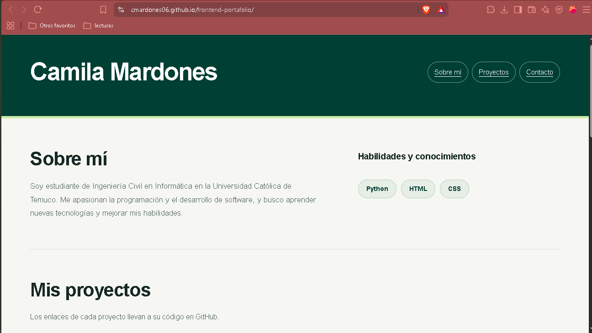
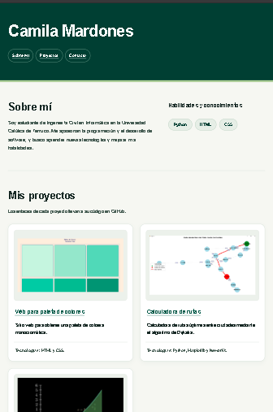
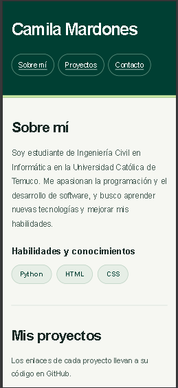
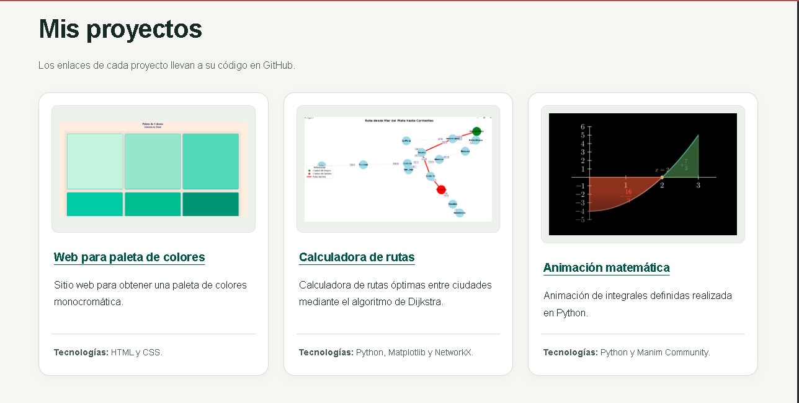

# Camila Mardones | Portafolio

**Enlace a versión web:** https://cmardones06.github.io/frontend-portafolio/

Portafolio personal desarrollado para la evaluación P2 de Desarrollo de Frontend, en la Universidad Católica de Temuco. Presenta mi formación, habilidades, proyectos y datos de contacto mediante una página construida con HTML y CSS.

El proyecto también está pensado como una **plantilla de portafolio para programadores**: sus textos, imágenes y enlaces se pueden reemplazar para adaptarlo a otro perfil.

## Audiencia y propósito

La página está dirigida a docentes, reclutadores y personas interesadas en conocer mis trabajos. Esta audiencia necesita identificar quién soy, qué tecnologías utilizo, revisar ejemplos de mis proyectos y encontrar una forma de contactarme.

La plantilla también considera al programador que la quiera reutilizar. Por eso, el HTML se organiza en secciones reconocibles y los estilos se mantienen en archivos separados.

El contenido se presenta en este orden:

1. **Sobre mí:** formación y áreas de aprendizaje.
2. **Mis proyectos:** trabajos con descripción, tecnologías, captura y enlace al código.
3. **Contacto:** dirección de correo y formulario para preparar un mensaje (no funcional).

## Capturas

| Escritorio | Tablet | Móvil |
|---|---|---|
|  |  |  |



## Tecnologías utilizadas

| Tecnología | Uso en el portafolio |
|---|---|
| **HTML5** | Estructura semántica, navegación, imágenes y formulario. |
| **CSS3** | Colores, tipografía, espaciado y adaptación a diferentes pantallas. |
| **Flexbox** | Distribución del menú y organización de los campos del formulario. |
| **CSS Grid** | Distribución de las tarjetas de proyectos. |
| **Media queries** | Cambios de diseño según el ancho y las preferencias del usuario. |

## Estructura de carpetas

```text
portafolio/
├── index.html
├── README.md
└── assets/
    ├── styles/
    │   ├── style.css
    │   └── accesibilidad.css
    └── img/
        ├── colores.png
        ├── rutas.png
        └── animacion.png
```

- **`index.html`:** contenido y estructura de la página.
- **`style.css`:** presentación general y puntos de quiebre para el diseño responsivo.
- **`accesibilidad.css`:** contraste, foco, formulario y ajustes para preferencias de accesibilidad. Se carga después del CSS principal.
- **`assets/img/`:** capturas de los proyectos mostrados en las tarjetas.

## Cómo abrir el proyecto

1. Descargar el repositorio desde **Code → Download ZIP** y descomprimirlo, o utilizar una copia local del proyecto.
2. Comprobar que `index.html` esté en la raíz y que la carpeta `assets` conserve su estructura.
3. Abrir `index.html` en un navegador.

También se puede abrir la carpeta en **Visual Studio Code** y utilizar **Live Server**, si la extensión está instalada. No es obligatorio usar un servidor local.

Los enlaces a repositorios requieren conexión a Internet. El contenido local y los estilos pueden consultarse sin conexión.

## Decisiones de diseño

- **Nombre visible en el encabezado:** Permite identificar rápidamente a quién pertenece el portafolio.
- **Navegación mediante enlaces internos:** Facilita llegar a la información personal, los proyectos y el contacto.
- **Presentación antes de los proyectos:** Entrega contexto sobre mi formación antes de mostrar los trabajos.
- **Proyectos organizados en tarjetas:** Agrupa captura, descripción y tecnologías para facilitar la comparación.
- **Títulos de proyectos enlazados a GitHub:** Permite que el visitante consulte el código y amplíe la información.
- **Fondo claro y verde como color principal:** Mantiene una apariencia sencilla y da énfasis al encabezado, títulos y acciones.
- **Tipografía Arial y espaciado entre bloques:** Favorece la lectura y evita depender de fuentes externas.
- **Imágenes de ancho flexible:** Permite ver las capturas completas conservando sus proporciones.
- **CSS separado del HTML:** Facilita mantener el proyecto y reutilizar la plantilla.

## Diseño responsivo

El diseño parte de una distribución de una columna para pantallas pequeñas. El archivo `style.css` contiene **tres puntos de quiebre**:

- **Menos de 480 px:** Proyectos en una columna y relleno del contenido de 20 px.
- **Desde 480 px:** El relleno del contenido aumenta a 30 px.
- **Desde 768 px:** Los proyectos se distribuyen en dos columnas.
- **Desde 1024 px:** Los proyectos se distribuyen en tres columnas.

El menú permite distribuir enlaces en varias líneas. Las imágenes conservan sus proporciones y los campos del formulario se ajustan al espacio disponible. El contenido principal tiene un ancho máximo de 1100 px.

## Accesibilidad y buenas prácticas

Se aplican medidas relacionadas con las pautas **WCAG** y se utilizan atributos **WAI-ARIA** cuando ayudan a identificar contenido o relacionar instrucciones.

- **Idioma y título:** `lang="es"` y un título que identifica a la autora y el contenido.
- **HTML semántico:** uso de `header`, `nav`, `main`, `section`, `article` y `footer`.
- **Encabezados jerárquicos:** un `h1`, títulos `h2` para las secciones y `h3` para habilidades y proyectos.
- **Regiones identificadas:** nombre del menú y del formulario con `aria-label`; asociación de secciones y artículos a sus títulos mediante `aria-labelledby`.
- **Textos alternativos:** cada imagen tiene un `alt` que describe su contenido.
- **Salto al contenido:** enlace al inicio del documento para omitir el menú. El destino utiliza `tabindex="-1"` para recibir el foco sin añadir una parada al recorrido normal.
- **Navegación por teclado:** enlaces y controles nativos, sin valores positivos de `tabindex`.
- **Foco visible:** contorno de alto contraste en enlaces, botón, campos y destinos de navegación.
- **Contraste:** texto oscuro sobre fondos claros y texto blanco sobre verde en el encabezado y el botón. Los enlaces se subrayan para no identificarlos únicamente mediante el color.
- **Formulario etiquetado:** cada `label` se vincula con su campo mediante `for` e `id`, y la obligatoriedad se indica en el texto y con `required`.
- **Entrada de datos:** autocompletado para nombre y correo, tipo `email` y ejemplo de formato asociado mediante `aria-describedby`.
- **Validación nativa:** el navegador comprueba los campos obligatorios y el formato básico del correo. Esto no verifica que la dirección exista.
- **Ampliación y adaptación:** el zoom no se bloquea, las imágenes son fluidas y el texto largo puede ajustarse en tarjetas y dirección de contacto.
- **Preferencias del sistema:** reglas para movimiento reducido y colores forzados.

## Cómo reutilizar la plantilla

1. Cambiar el nombre del encabezado, el título, la descripción de la página y el pie.
2. Reemplazar la biografía y las habilidades por información propia.
3. Editar las tarjetas con proyectos reales, sus tecnologías, enlaces y capturas.
4. Actualizar los textos alternativos para que correspondan a las nuevas imágenes.
5. Cambiar la dirección de contacto en el enlace y en el atributo `action` del formulario.
6. Personalizar los estilos y comprobar de nuevo el contraste si se cambian colores.
7. Mantener identificadores únicos y actualizar sus referencias ARIA si se duplican tarjetas.
